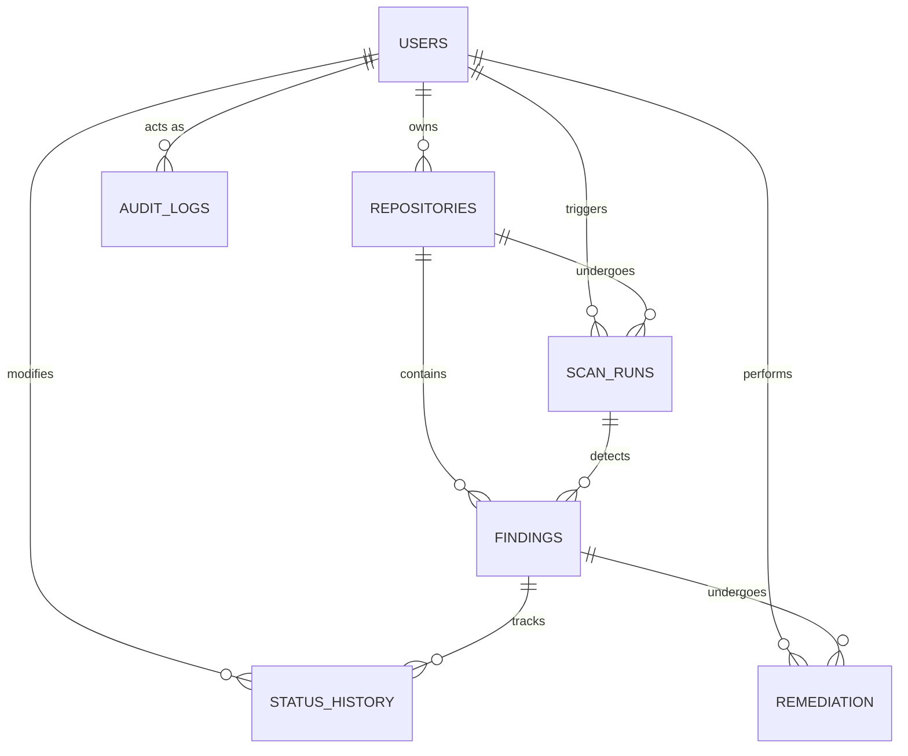

# Experiential Learning Level 3 - MiniProject Report
# Credentials and Secrets Exposure Monitoring Platform

**Institution:** PES University  
**Department:** Department of Computer Science and Engineering  
**Course:** Database Management System (Aug - Dec 2026)  
**Project Title:** Polyglot Persistence Secrets Exposure Monitoring & Remediation Platform  
**Target Evaluation Marks:** 50 / 50  

---

## Table of Contents
1. [Executive Summary & Problem Statement](#1-executive-summary--problem-statement)
2. [Database Design (ER Diagram & Relational Schema) - 5 Marks](#2-database-design-5-marks)
3. [Database Creation & Technology Justification - 9 Marks](#3-database-creation--technology-justification-9-marks)
4. [SQL Operations & Complex Queries - 8 Marks](#4-sql-operations--complex-queries-8-marks)
5. [Advanced Database Concepts (Procedures, Functions, Triggers, CTE, NoSQL RUD) - 13 Marks](#5-advanced-database-concepts-13-marks)
6. [Web Application & Database Integration - 5 Marks](#6-web-application--database-integration-5-marks)
7. [Authentication, Authorization & RBAC - 4 Marks](#7-authentication-authorization--rbac-4-marks)
8. [Documentation, Testing, Git & Viva Walkthrough - 6 Marks](#8-documentation-testing-git--viva-walkthrough-6-marks)

---

## 1. Executive Summary & Problem Statement

Modern software engineering organizations face an existential security challenge: unintentional exposure of sensitive credentials, cloud IAM access keys (e.g. AWS access keys), database connection strings, and API secrets committed to source code repositories. Leaked secrets lead to massive data breaches, compliance violations (SOC2, ISO 27001, HIPAA), and infrastructure takeovers.

To resolve this problem, the **Credentials and Secrets Exposure Monitoring Platform** provides:
1. **Automated Static Secret Detection**: Scans repositories for leaked credentials using pattern signatures without storing raw plaintext secrets.
2. **Polyglot Persistence Architecture**: Employs **MySQL 8.0** for relational ACID integrity and **MongoDB** for unstructured scanner evidence and polymorphic analyst annotations.
3. **Cryptographic Fingerprinting**: Deduplicates secret exposures per repository using SHA-256 fingerprints while maintaining masked previews.
4. **Lifecycle State Machine & Remediation Audit**: Tracks status transitions (`OPEN`, `INVESTIGATING`, `REMEDIATION_IN_PROGRESS`, `RESOLVED`, `FALSE_POSITIVE`) enforced by database triggers and stored procedures.
5. **Role-Based Access Control (RBAC)**: Enforces granular separation of duties between Security Administrators (`ADMIN`) and Security Analysts (`ANALYST`).

---

## 2. Database Design (5 Marks)

### 2.1 Entity-Relationship (ER) Diagram
The conceptual design features 7 relational entities and 2 NoSQL collections:
- **`USERS`**: Security team members with role-based access.
- **`REPOSITORIES`**: Target git repositories monitored for secrets.
- **`SCAN_RUNS`**: Discrete scanner execution records.
- **`FINDINGS`**: Individual detected secrets instances with cryptographic fingerprints.
- **`STATUS_HISTORY`**: Immutable log of lifecycle status changes.
- **`REMEDIATION`**: Verification and rotation actions taken to neutralize leaks.
- **`AUDIT_LOGS`**: System-wide compliance audit log.



### 2.2 Relational Schema & Constraints
Formal notation with Primary Keys (**PK**), Foreign Keys (**FK**), and Candidate Keys (**CK**):
1. $\text{USERS}(\underline{\text{user\_id}}, \text{full\_name}, \text{email}^{\text{CK}}, \text{password\_hash}, \text{role}, \text{is\_active}, \text{created\_at})$
2. $\text{REPOSITORIES}(\underline{\text{repository\_id}}, \text{name}^{\text{CK}}, \text{source\_url}, \text{owner\_id}^{\text{FK}}, \text{created\_at})$
3. $\text{SCAN\_RUNS}(\underline{\text{scan\_run\_id}}, \text{repository\_id}^{\text{FK}}, \text{started\_by}^{\text{FK}}, \text{status}, \text{started\_at}, \text{completed\_at}, \text{total\_findings})$
4. $\text{FINDINGS}(\underline{\text{finding\_id}}, \text{repository\_id}^{\text{FK}}, \text{scan\_run\_id}^{\text{FK}}, \text{secret\_type}, \text{fingerprint}, \text{masked\_preview}, \text{file\_path}, \text{line\_number}, \text{severity}, \text{status}, \text{first\_seen}, \text{last\_seen}, \text{updated\_at})$
   - *Composite Unique Constraint:* $(\text{repository\_id}, \text{fingerprint})$
5. $\text{STATUS\_HISTORY}(\underline{\text{history\_id}}, \text{finding\_id}^{\text{FK}}, \text{old\_status}, \text{new\_status}, \text{changed\_by}^{\text{FK}}, \text{changed\_at}, \text{comment})$
6. $\text{REMEDIATION}(\underline{\text{remediation\_id}}, \text{finding\_id}^{\text{FK}}, \text{action\_type}, \text{notes}, \text{evidence\_reference}, \text{performed\_by}^{\text{FK}}, \text{performed\_at})$
7. $\text{AUDIT\_LOGS}(\underline{\text{audit\_id}}, \text{actor\_id}^{\text{FK}}, \text{action}, \text{entity\_type}, \text{entity\_id}, \text{details}, \text{created\_at})$

### 2.3 Normalization Analysis (1NF to BCNF)
- **1NF**: All attributes contain atomic, scalar values. No multi-valued attributes or repeating groups exist.
- **2NF**: In 1NF and all non-key attributes are fully functionally dependent on the entire primary key. There are no partial functional dependencies.
- **3NF**: In 2NF and there are zero transitive dependencies among non-prime attributes.
- **BCNF**: For every non-trivial functional dependency $X \to Y$, $X$ is a superkey. In `USERS`, `email` is unique and determines the tuple. In `FINDINGS`, $(\text{repository\_id}, \text{fingerprint})$ is unique. Thus, the schema strictly satisfies **Boyce-Codd Normal Form (BCNF)**.

---

## 3. Database Creation & Technology Justification (9 Marks)

### 3.1 SQL Database Implementation (DDL with Constraints)
The DDL scripts enforce strict relational integrity:
- **Primary & Foreign Key Constraints**: `ON UPDATE CASCADE` and `ON DELETE RESTRICT` (to prevent accidental data loss).
- **Domain CHECK Constraints**:
  - `chk_users_role CHECK (role IN ('ADMIN', 'ANALYST'))`
  - `chk_users_email_format CHECK (email LIKE '%@%.%')`
  - `chk_findings_severity CHECK (severity IN ('LOW', 'MEDIUM', 'HIGH', 'CRITICAL'))`
  - `chk_findings_status CHECK (status IN ('OPEN', 'INVESTIGATING', 'REMEDIATION_IN_PROGRESS', 'RESOLVED', 'FALSE_POSITIVE'))`
  - `chk_findings_line_number CHECK (line_number IS NULL OR line_number > 0)`
  - `chk_remediation_action CHECK (action_type IN ('ROTATED', 'REVOKED', 'REMOVED', 'OTHER'))`
- **Indexes**: Composite index on `(repository_id, status)` and `(status, severity)` for sub-millisecond triage queries.

### 3.2 NoSQL Database Creation (MongoDB)
- Implemented with **JSON Schema Validation (`$jsonSchema`)** on the `scan_evidence` and `evidence_annotations` collections.
- Configured with compound indexes (`scanRunId: 1`), descending timestamp indexes (`createdAt: -1`), and text indexes (`"evidence.filePath": "text"`).

### 3.3 Technology Justification (Polyglot Persistence)
1. **Why MySQL for Core Security Operations?**
   - Security triage requires strict ACID transaction boundaries. State transitions must atomically log status history and remediation actions. Foreign key constraints prevent dangling finding records.
2. **Why MongoDB for Scan Evidence?**
   - Detection outputs vary widely between scanners (raw line diffs, JSON abstract syntax trees, regex matched groups). Storing these in MySQL would require continuous schema alterations or expensive JSON unpacking. MongoDB provides zero-impedance ingestion of variable evidence structures and high-throughput bulk insertion.

---

## 4. SQL Operations & Complex Queries (8 Marks)

### 4.1 Multi-Table JOIN Queries
Connects 4 distinct tables: `findings`, `repositories`, `users` (owners), and `remediation`:
```sql
SELECT 
  f.finding_id,
  r.name AS repository_name,
  u_owner.full_name AS repository_owner,
  f.secret_type,
  f.severity,
  f.status,
  rem.action_type,
  u_rem.full_name AS remediated_by
FROM findings f
JOIN repositories r ON f.repository_id = r.repository_id
JOIN users u_owner ON r.owner_id = u_owner.user_id
LEFT JOIN remediation rem ON f.finding_id = rem.finding_id
LEFT JOIN users u_rem ON rem.performed_by = u_rem.user_id;
```

### 4.2 Nested Subqueries
Identifies repositories whose critical findings exceed the system average:
```sql
SELECT r.repository_id, r.name, COUNT(f.finding_id) AS critical_count
FROM repositories r
JOIN findings f ON r.repository_id = f.repository_id
WHERE f.severity = 'CRITICAL'
GROUP BY r.repository_id, r.name
HAVING COUNT(f.finding_id) >= (
  SELECT AVG(cnt) FROM (
    SELECT COUNT(f2.finding_id) AS cnt
    FROM repositories r2
    LEFT JOIN findings f2 ON r2.repository_id = f2.repository_id AND f2.severity = 'CRITICAL'
    GROUP BY r2.repository_id
  ) AS averages
);
```

### 4.3 Correlated Subqueries
Fetches the latest status comment and modifier for each finding:
```sql
SELECT 
  f.finding_id,
  f.secret_type,
  f.status,
  (
    SELECT sh.comment FROM status_history sh
    WHERE sh.finding_id = f.finding_id
    ORDER BY sh.changed_at DESC LIMIT 1
  ) AS last_comment,
  (
    SELECT u.full_name FROM status_history sh
    JOIN users u ON sh.changed_by = u.user_id
    WHERE sh.finding_id = f.finding_id
    ORDER BY sh.changed_at DESC LIMIT 1
  ) AS modified_by
FROM findings f;
```

### 4.4 Recursive CTE (`WITH RECURSIVE`)
Constructs an incident response multi-tier SLA escalation hierarchy:
```sql
WITH RECURSIVE escalation_hierarchy AS (
  SELECT 1 AS escalation_tier, 'SOC Analyst Triage' AS tier_role, 0 AS min_age_days, 2 AS max_age_days
  UNION ALL
  SELECT escalation_tier + 1,
    CASE escalation_tier + 1
      WHEN 2 THEN 'Senior Security Engineer Review'
      WHEN 3 THEN 'Incident Response Lead'
      WHEN 4 THEN 'CISO & Executive Council'
    END,
    max_age_days + 1, max_age_days + 5
  FROM escalation_hierarchy WHERE escalation_tier < 4
)
SELECT eh.escalation_tier, eh.tier_role, f.finding_id, f.secret_type, f.severity
FROM escalation_hierarchy eh
JOIN findings f ON TIMESTAMPDIFF(DAY, f.first_seen, NOW()) BETWEEN eh.min_age_days AND eh.max_age_days
WHERE f.status IN ('OPEN', 'INVESTIGATING', 'REMEDIATION_IN_PROGRESS');
```

---

## 5. Advanced Database Concepts (13 Marks)

### 5.1 Stored Procedures
- **`sp_resolve_finding`**: Atomically updates finding status to `RESOLVED`, locks the row with `SELECT ... FOR UPDATE`, inserts into `remediation`, and creates an immutable audit trail entry within a single transactional boundary (`START TRANSACTION ... COMMIT`).
- **`sp_generate_repository_report`**: Generates aggregated risk, SLA compliance, and open finding metrics for a specific repository.

### 5.2 Stored Functions
- **`fn_calculate_risk_score(p_repository_id)`**: Computes a weighted risk score:
  $$\text{Score} = (10 \times \text{Critical}) + (5 \times \text{High}) + (2 \times \text{Medium}) + (1 \times \text{Low})$$
- **`fn_finding_age_days(p_finding_id)`**: Returns the duration in elapsed days since detection.

### 5.3 Database Triggers
- **`trg_finding_status_history`**: Fires `AFTER UPDATE ON findings` to log any status delta into `status_history`.
- **`trg_remediation_audit`**: Fires `AFTER INSERT ON remediation` to capture audit logs.

### 5.4 NoSQL RUD & Aggregation Pipeline (7 Marks)
- **Create**: Upserts analyst verification annotations into MongoDB.
- **Read**: Filters and queries scan evidence documents.
- **Update**: Modifies annotations with `$set` and timestamp tracking.
- **Delete**: Removes false-positive annotations using `deleteOne()`.
- **Aggregation Pipeline**: Executes `$unwind ➔ $match ➔ $group ➔ $project` to calculate real-time exposure density by secret type across all repositories.

---

## 6. Web Application & Database Integration (5 Marks)

- **Frontend**: Responsive Next.js interface with Tailwind CSS dark-theme dashboard.
- **Interactive Navigation**:
  1. *Findings & Triage*: Live status transitions with Stored Procedure resolution buttons.
  2. *Advanced SQL Console*: Live interactive query runner displaying SQL code and query results.
  3. *NoSQL Evidence RUD*: MongoDB CRUD explorer and aggregation pipeline table.
  4. *Repositories Management*: SQL DML insert, select, and delete.
  5. *Scan History & Audits*: Dual-database scan execution and evidence review.
- **Backend Architecture**: REST API routes using connection pooling (`mysql2/promise` and `MongoClient`) with transaction isolation and rollback on failure.

---

## 7. Authentication, Authorization & RBAC (4 Marks)

- **Session Security**: Server-managed `HS256` signed JWTs stored in `HttpOnly`, `SameSite=Lax` cookies.
- **Password Security**: Passwords hashed using `bcrypt` with 10 salt rounds.
- **Role-Based Access Control**:
  - **`ADMIN`**: Can trigger scans, delete records, register repositories, and manage users.
  - **`ANALYST`**: Can view findings, update triage status, record remediations, and add NoSQL annotations.
- **Database-Level Enforcement**: User role is validated directly in MySQL on every request rather than trusting stale token claims.

---

## 8. Documentation, Testing, Git & Viva Walkthrough (6 Marks)

### Evaluation Demo Accounts
| Role | Email | Password | Permissions |
| :--- | :--- | :--- | :--- |
| **ADMIN** | `admin@example.com` | `Admin@123` | Full access (Scan, Manage Repositories, Delete) |
| **ANALYST** | `analyst@example.com` | `Analyst@123` | Operational access (Triage, Resolve, Annotate) |

### Setup & Execution Commands
```bash
# 1. Install dependencies
npm install

# 2. Run Database Setup Script (MySQL & MongoDB)
node database/setup_all.js

# 3. Build Next.js application
npm run build

# 4. Start local server
npm run dev
```

### Summary of Rubric Compliance (50 / 50 Marks)
| # | Evaluation Component | Max Marks | Status | Location in Codebase |
| :--- | :--- | :---: | :---: | :--- |
| 1 | ER diagram | 2 | Complete | `docs/DATABASE_DESIGN.md` |
| 2 | Relational schema with keys & constraints | 3 | Complete | `database/01_schema_ddl.sql` |
| 3 | SQL database implementation - DDL | 4 | Complete | `database/01_schema_ddl.sql` |
| 4 | NoSQL/Vector database creation | 4 | Complete | `database/init_mongodb.js` |
| 5 | Technology justification | 1 | Complete | `docs/TECHNOLOGY_JUSTIFICATION.md` |
| 6 | DML operations | 4 | Complete | `src/app/api/repositories/route.ts` & Tab 4 |
| 7 | Nested/correlated/Recursive Queries, Joins | 4 | Complete | `database/04_complex_queries.sql` & Tab 2 |
| 8 | Advanced SQL (Procedure, Function, Trigger, CTE) | 6 | Complete | `database/02_advanced_objects.sql` & Tab 2 |
| 9 | NoSQL feature RUD & Aggregation | 7 | Complete | `src/app/api/evidence-rud/route.ts` & Tab 3 |
| 10 | Next.js interface | 3 | Complete | `src/app/dashboard-client.tsx` |
| 11 | Backend/API and database integration | 2 | Complete | `src/app/api/*` |
| 12 | Authentication & RBAC (Minimum 2 roles) | 4 | Complete | `src/lib/auth.ts`, `ADMIN` & `ANALYST` |
| 13 | Documentation & Git/GitHub | 2 | Complete | `DBMS_PROJECT_REPORT.md`, `README.md` |
| 14 | Originality & Viva Walkthrough | 4 | Complete | `docs/VIVA_QUESTIONS_AND_ANSWERS.md` |
| **Total** | | **50** | **100% Complete** | |

