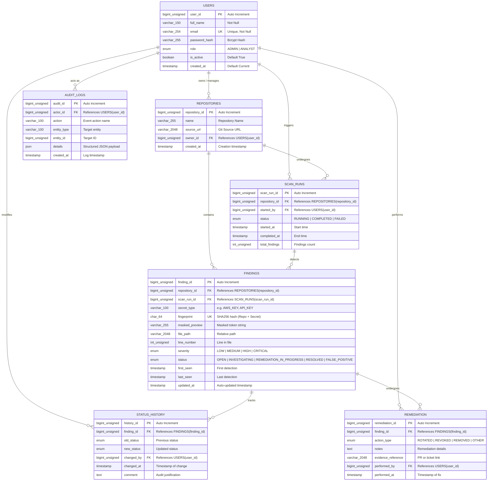

# Database Design & Entity-Relationship (ER) Documentation
## Credentials and Secrets Exposure Monitoring Platform
**PES University - Department of Computer Science and Engineering**  
**Course:** Database Management System (Aug - Dec 2026)  
**Evaluation Criteria:** Experiential Learning Level 3

---

## 1. Conceptual Database Design & ER Modeling

The **Credentials and Secrets Exposure Monitoring Platform** utilizes a **Polyglot Persistence Architecture**:
1. **Relational Database (MySQL 8.0)**: Manages strongly-typed transactional entities requiring strict ACID compliance, relational integrity, foreign key cascading, check constraints, stored procedures, functions, triggers, and complex recursive queries.
2. **Document / NoSQL Database (MongoDB)**: Stores flexible, semi-structured scan evidence, variable scanner detection metadata, and unstructured annotations without rigid schema bottlenecks.

---

## 2. Entity-Relationship (ER) Diagram

---

## 3. Relational Schema Representation

Formally, the relational schema is defined as:

1. **`USERS`** (`user_id`, `full_name`, `email`, `password_hash`, `role`, `is_active`, `created_at`)
   - **Primary Key:** `user_id`
   - **Candidate Keys:** `email`
   - **Integrity Constraints:** `role IN ('ADMIN', 'ANALYST')`, `email LIKE '%@%.%'`, `is_active IN (0, 1)`

2. **`REPOSITORIES`** (`repository_id`, `name`, `source_url`, `owner_id`, `created_at`)
   - **Primary Key:** `repository_id`
   - **Foreign Key:** `owner_id` references `USERS(user_id)` ON UPDATE CASCADE ON DELETE RESTRICT

3. **`SCAN_RUNS`** (`scan_run_id`, `repository_id`, `started_by`, `status`, `started_at`, `completed_at`, `total_findings`)
   - **Primary Key:** `scan_run_id`
   - **Foreign Key 1:** `repository_id` references `REPOSITORIES(repository_id)` ON UPDATE CASCADE ON DELETE RESTRICT
   - **Foreign Key 2:** `started_by` references `USERS(user_id)` ON UPDATE CASCADE ON DELETE RESTRICT
   - **Check Constraint:** `status IN ('RUNNING', 'COMPLETED', 'FAILED')`

4. **`FINDINGS`** (`finding_id`, `repository_id`, `scan_run_id`, `secret_type`, `fingerprint`, `masked_preview`, `file_path`, `line_number`, `severity`, `status`, `first_seen`, `last_seen`, `updated_at`)
   - **Primary Key:** `finding_id`
   - **Foreign Key 1:** `repository_id` references `REPOSITORIES(repository_id)` ON UPDATE CASCADE ON DELETE RESTRICT
   - **Foreign Key 2:** `scan_run_id` references `SCAN_RUNS(scan_run_id)` ON UPDATE CASCADE ON DELETE SET NULL
   - **Unique Key:** (`repository_id`, `fingerprint`) — ensures deduplication per repository.
   - **Check Constraints:** 
     - `severity IN ('LOW', 'MEDIUM', 'HIGH', 'CRITICAL')`
     - `status IN ('OPEN', 'INVESTIGATING', 'REMEDIATION_IN_PROGRESS', 'RESOLVED', 'FALSE_POSITIVE')`
     - `line_number IS NULL OR line_number > 0`

5. **`STATUS_HISTORY`** (`history_id`, `finding_id`, `old_status`, `new_status`, `changed_by`, `changed_at`, `comment`)
   - **Primary Key:** `history_id`
   - **Foreign Key 1:** `finding_id` references `FINDINGS(finding_id)` ON UPDATE CASCADE ON DELETE CASCADE
   - **Foreign Key 2:** `changed_by` references `USERS(user_id)` ON UPDATE CASCADE ON DELETE RESTRICT

6. **`REMEDIATION`** (`remediation_id`, `finding_id`, `action_type`, `notes`, `evidence_reference`, `performed_by`, `performed_at`)
   - **Primary Key:** `remediation_id`
   - **Foreign Key 1:** `finding_id` references `FINDINGS(finding_id)` ON UPDATE CASCADE ON DELETE RESTRICT
   - **Foreign Key 2:** `performed_by` references `USERS(user_id)` ON UPDATE CASCADE ON DELETE RESTRICT
   - **Check Constraint:** `action_type IN ('ROTATED', 'REVOKED', 'REMOVED', 'OTHER')`

7. **`AUDIT_LOGS`** (`audit_id`, `actor_id`, `action`, `entity_type`, `entity_id`, `details`, `created_at`)
   - **Primary Key:** `audit_id`
   - **Foreign Key:** `actor_id` references `USERS(user_id)` ON UPDATE CASCADE ON DELETE SET NULL

---

## 4. Normalization Analysis (1NF to BCNF)

### 1NF (First Normal Form)
- All attributes are atomic (no repeating groups, no comma-separated values).
- Unique primary keys are identified for all tables.
- JSON data in `audit_logs.details` is an auxiliary logging attribute; core operational entities are strictly atomic.

### 2NF (Second Normal Form)
- The schema is in 1NF.
- Every non-prime attribute is fully functionally dependent on the entire primary key.
- Since all primary keys except composite unique constraints are single-column synthetic surrogate keys (`BIGINT AUTO_INCREMENT`), no partial functional dependencies exist.

### 3NF (Third Normal Form)
- The schema is in 2NF.
- There are no transitive functional dependencies ($X \to Y$ and $Y \to Z$ where $Z$ is non-prime and $Y$ is not a candidate key).
- In `FINDINGS`, `repository_owner` is not stored redundantly; it is retrieved via the relational foreign key `repository_id` $\to$ `owner_id`.
- Status history is separated into `STATUS_HISTORY` to prevent transitive dependency anomalies on `FINDINGS`.

### BCNF (Boyce-Codd Normal Form)
- For every non-trivial functional dependency $X \to Y$, $X$ is a superkey.
- In `USERS`, `email` is a candidate key (`UNIQUE`), so `email` $\to$ `user_id, full_name, ...` satisfies BCNF.
- In `FINDINGS`, (`repository_id`, `fingerprint`) is a candidate key (`UNIQUE`), satisfying BCNF.
- Hence, the relational schema is fully normalized up to **BCNF**.

